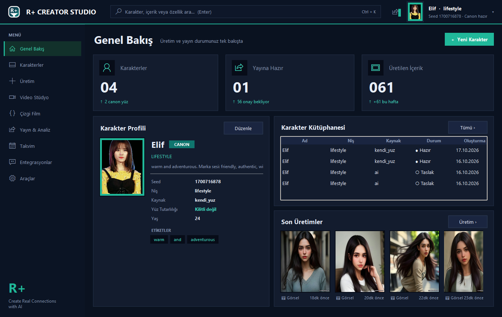
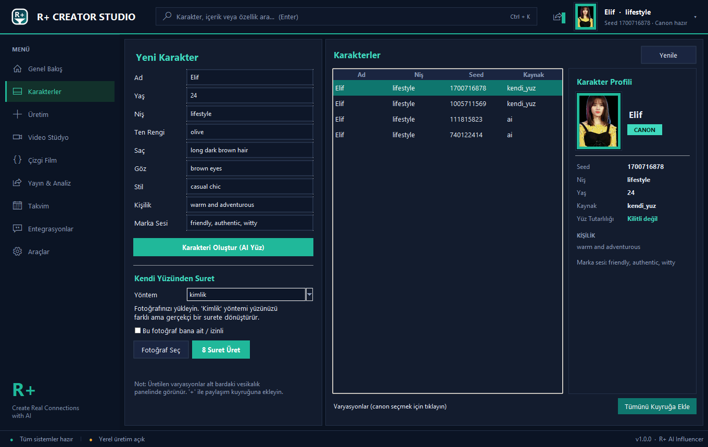
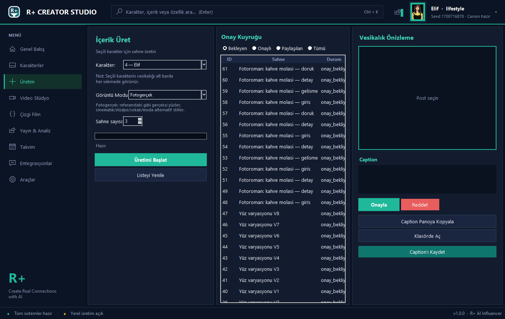
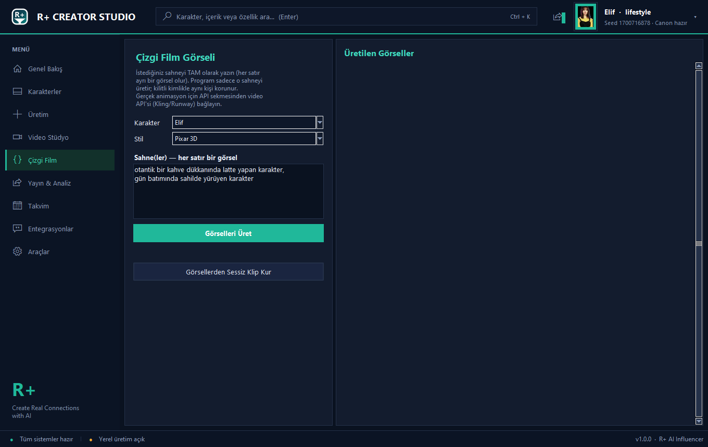
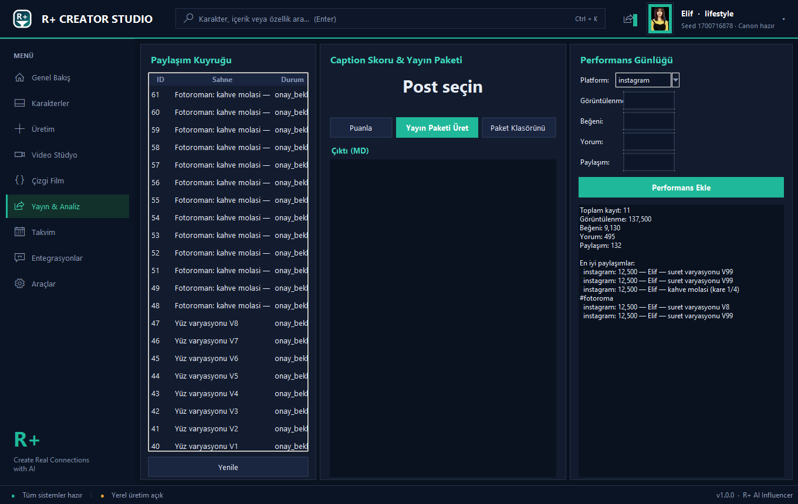
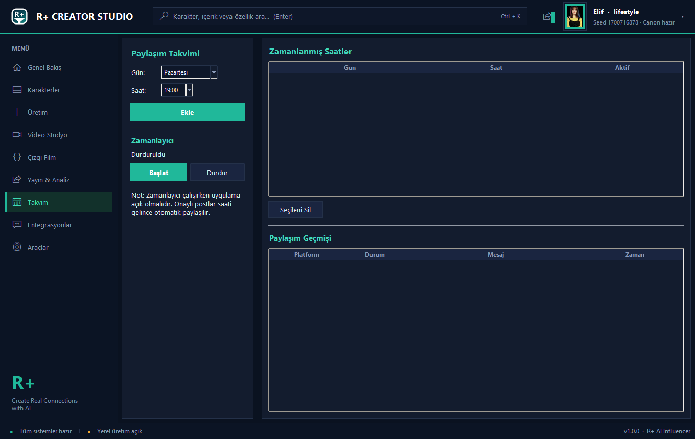

# R+ AI Influencer — Ücretsiz Sanal Influencer Otomasyonu

> **Ücretsiz, open-source AI influencer üretimi ve otomatik paylaşım masaüstü uygulaması.**
> Kendi sanal influencer'ını yarat, **fotogerçekçi karakterler** üret, günlük içeriği Instagram & TikTok'a otomatik paylaş — hepsi tek uygulamada, **$0 maliyetle**.

[English](#english) · [Özellikler](#özellikler) · [Görüntü Modları](#görüntü-modları) · [Kurulum](#kurulum) · [Kullanım](#kullanım) · [Ekran Görüntüleri](#ekran-görüntüleri)



**Anahtar sözcükler:** AI influencer · sanal influencer · virtual influencer generator · ücretsiz AI içerik üretimi · fotogerçekçi AI karakter · consistent AI character · otomatik Instagram paylaşım · TikTok otomasyonu · self-hosted influencer · open source virtual influencer · Pollinations AI · yapay zeka dijital influencer

---

## Neden R+ AI Influencer?

Piyasadaki sanal influencer platformları **$19–99/ay** ücret talep eder (The Influencer AI, APOB AI, Influverse...). R+ AI Influencer aynı yetenekleri **ücretsiz ve self-hosted** sunar:

| | R+ AI Influencer | Premium Platformlar |
|---|---|---|
| Ücret | **$0 (MIT)** | $19–99/ay |
| Fotogerçekçi karakter modları | ✅ 5 mod | ✅ |
| Yüz tutarlılığı kilidi | ✅ seed + ArcFace | ✅ |
| Kendi yüzünden suret (offline) | ✅ internetsiz | ❌ |
| Otomatik zamanlı paylaşım | ✅ IG + TikTok | ✅ |
| API'siz çalışabilir | ✅ Pollinations | ❌ |
| Veriler senin bilgisayarında | ✅ SQLite | ❌ cloud |

---

## Özellikler

### 🎭 Karakter Stüdyosu (tek panel)

- Ad, yaş, niş, ten, saç, göz, stil, kişilik, marka sesi tek profesyonel panelde
- **Seed kilidi**: her üretimde aynı yüz kimliği
- **Canon + kimlik kilidi (ArcFace)**: kilitli kimlik tüm üretimlerde (post, çizgi film, video) aynı kişiyi korur
- 7 niş × 8 sahne şablonu: lifestyle, moda, fitness, tech, yemek, seyahat, güzellik
- Kendi fotoğrafından **internetsiz** 8 suret (MediaPipe 478 landmark + Delaunay warp)

### 🖼️ Görüntü Modları — fotogerçekçi karakter üretimi

Üretim sekmesindeki **"Görüntü Modu"** seçici ile prompt stili anında değişir:

| Mod | Stil |
|---|---|
| **Fotogerçek** (varsayılan) | Sony A7 III, 85mm f/1.4, doğal cilt gözenekleri, film graini — gerçek fotoğraf |
| **Sinematik** | Kodak Portra, anamorphic flare, dramatik ışık, film still |
| **Stüdyo Portre** | Softbox key light, seamless backdrop, headshot |
| **Doğaçka Sokak** | Golden hour, doğal bokeh, candid belgesel |
| **Editoryal Moda** | Vogue tarzı, designer kombin, editoryal ışık |

Mod, tüm üretim akışlarında (toplu üretim, kanon yüz adayı, fotoroman, marka kiti) otomatik uygulanır ve ayarlar olarak kalıcıdır.

### 🤖 Ücretsiz AI İçerik Üretimi
- **Pollinations.ai Flux** ile fotogerçekçi görsel (API anahtarsız, ücretsiz)
- Caption + hashtag üretimi (AI text, şablon yedeğiyle)
- Toplu üretim: tek tıkla 1–10 sahne + ilerleme çubuğu
- **Kimlik uygulama**: kilitli ArcFace kimliği üretilen yüze işlenir → stabil karakter

### 🎬 Çizgi Film & Video Stüdyosu

- Sahne-satırı-prompt: her satır ayrı görsel, kilitli kimlik korunur
- Pixar / anime / cel-shading stilleri (fotogerçek token'ları otomatik temizlenir)
- Sessiz klip kurma (ffmpeg) + seslendirme (gTTS/edge-TTS)

### 📅 Zamanlama & Yayın

- Gün/saat bazlı paylaşım takvimi + otomatik zamanlayıcı
- Instagram Graph API + TikTok Content Posting API (taslak/direct)
- Manuel mod: klasörde aç + caption panoya kopyala
- Yayın skoru, trend fikirleri, performans takibi

### 🔌 Çoklu API Desteği
Key'i yapıştır — sistem otomatik tanır: OpenAI (DALL·E 3), Stability, Replicate, HuggingFace, Groq, Together, DeepSeek, Mistral. **API yoksa otomatik Pollinations.ai** kullanılır.

---

## Ekran Görüntüleri

| | |
|---|---|
|  |  |
| **Ultra-premium dark karakter stüdyosu** | **Görüntü modu seçicili üretim merkezi** |
|  |  |
| **Sahne-tabanlı çizgi film** | **Zamanlı paylaşım takvimi** |

---

## Kurulum

### Gereksinimler
- Python 3.10+ (Windows / macOS / Linux)
- ffmpeg (video özellikleri için, ops.)

### Kurulum

```bash
git clone https://github.com/RetroNyym/r-ai-influencer.git
cd r-ai-influencer
pip install -r requirements.txt
```

### Çalıştırma

```bash
python baslat.py
```

Windows'ta: `baslat.bat` · PyInstaller ile .exe: `pyinstaller ai_influencer.spec`

---

## Kullanım

1. **Karakter oluştur** — Karakter sekmesi: formu doldur → "Karakteri Oluştur (AI Yüz)" VEYA kendi fotoğrafınla offline suret üret
2. **Görüntü modunu seç** — Üretim sekmesi: Fotogerçek / Sinematik / Stüdyo / Sokak / Moda
3. **İçerik üret** — karakter + sahne sayısı → "Üretimi Başlat" → Onayla/Reddet
4. **Zamanla & paylaş** — Takvim: gün+saat ekle → "Zamanlayıcı Başlat"

---

## Teknoloji Stack

| Katman | Teknoloji |
|---|---|
| Arayüz | Python tkinter/ttk — ultra-premium dark tema, sidebar + dashboard |
| AI görsel | Pollinations.ai Flux (ücretsiz), OpenAI, Stability, Replicate |
| Yüz tutarlılığı | ArcFace kimlik kilidi + MediaPipe FaceLandmarker |
| Yerel dönüşüm | OpenCV (Delaunay warp), internetsiz |
| Depolama | SQLite (atomik yazma) |
| Paylaşım | Instagram Graph API, TikTok Content Posting API |
| Paketleme | PyInstaller |

---

## SEO Anahtar Kelimeler

AI influencer, sanal influencer, virtual influencer generator, AI influencer automation, ücretsiz AI influencer, open source virtual influencer, AI content creator, fotogerçekçi AI karakter, photorealistic AI character generator, consistent AI character, otomatik Instagram paylaşım, TikTok otomasyon, self-hosted influencer, face transform offline, MediaPipe face landmark, ArcFace identity lock, Pollinations AI free, stable diffusion free, AI avatar creator, dijital influencer, yapay zeka influencer, masaüstü influencer botu, retro+ AI, R+ Creator Studio

---

## Lisans

MIT License — özgürce kullan, değiştir, dağıt.

---

## English

**R+ AI Influencer Automation** — Free, open-source virtual influencer generation and auto-posting desktop app.

Create a consistent AI influencer persona, generate **photorealistic content in 5 image modes** (Photoreal, Cinematic, Studio, Street, Editorial Fashion), and auto-schedule posts to Instagram & TikTok — all from one desktop app, at $0 cost.

**Key features:**
- **5 image modes** for photorealistic AI characters — prompt style switches instantly
- Seed-locked + ArcFace identity lock → the same face in every image
- Upload your own photo → 8 **offline** face variations (MediaPipe + Delaunay warp, no internet)
- Free AI image + caption generation (Pollinations.ai Flux, no API key)
- Scene-based cartoon/animation generator + video studio (ffmpeg)
- Instagram Graph API + TikTok Content Posting API + scheduler
- Ultra-premium dark Turkish desktop GUI
- Multi-API support (OpenAI, Stability, Replicate, HuggingFace, Groq...) with auto-detection

```bash
git clone https://github.com/RetroNyym/r-ai-influencer.git
cd r-ai-influencer
pip install -r requirements.txt
python baslat.py
```

**Keywords:** AI influencer, virtual influencer generator, free AI content creator, photorealistic AI character, consistent AI face, Instagram auto-posting, TikTok automation, open source influencer bot, self-hosted AI avatar, Pollinations AI
